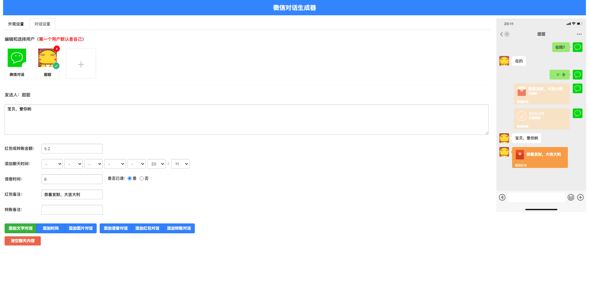

# 微信对话生成器

> 一款在线微信聊天对话制作工具，支持文字、语音、红包、转账等多种消息类型，可自定义手机状态栏、多用户角色，一键随机生成或加载系统预设，并支持截图导出。纯 PHP + Vue.js 构建，开箱即用。

* * *

## 目录

-   [功能特性](#%E5%8A%9F%E8%83%BD%E7%89%B9%E6%80%A7)
-   [演示截图](#%E6%BC%94%E7%A4%BA%E6%88%AA%E5%9B%BE)
-   [技术栈](#%E6%8A%80%E6%9C%AF%E6%A0%88)
-   [快速开始](#%E5%BF%AB%E9%80%9F%E5%BC%80%E5%A7%8B)
-   [目录结构](#%E7%9B%AE%E5%BD%95%E7%BB%93%E6%9E%84)
-   [配置说明](#%E9%85%8D%E7%BD%AE%E8%AF%B4%E6%98%8E)
-   [API 文档](#api-%E6%96%87%E6%A1%A3)
-   [系统预设](#%E7%B3%BB%E7%BB%9F%E9%A2%84%E8%AE%BE)
-   [使用指南](#%E4%BD%BF%E7%94%A8%E6%8C%87%E5%8D%97)
-   [常见问题](#%E5%B8%B8%E8%A7%81%E9%97%AE%E9%A2%98)
-   [免责声明](#%E5%85%8D%E8%B4%A3%E5%A3%B0%E6%98%8E)
-   [开源协议](#%E5%BC%80%E6%BA%90%E5%8D%8F%E8%AE%AE)

* * *

## 功能特性

### 核心能力

-   **多种消息类型**：文字、语音、红包、转账、系统通知，覆盖微信常见聊天场景
-   **多用户角色**：支持添加多个聊天角色，自由切换发言身份，自定义头像与昵称
-   **手机状态栏定制**：信号、WiFi、时间、电量、充电状态、耳机状态等均可调节
-   **iOS / 安卓外观**：模拟两种系统状态栏样式，逼真还原微信界面
-   **实时预览**：所见即所得，左侧编辑右侧实时同步渲染

### 一键生成

-   **一键随机**：点击即可随机生成一段完整对话，包含随机用户、消息、时间等
-   **系统预设**：内置 13 个精心编排的对话场景，覆盖情感、生活、职场、搞笑、节日、娱乐、社交等标签
-   **当前时间**：一键将聊天时间设为服务器当前时间，省去手动填写

### 导出能力

-   **全屏预览**：将生成的对话以纯图片形式全屏展示，方便审阅
-   **下载当前截图**：导出当前可见区域的手机截图（PNG，2 倍清晰度）
-   **下载长截图**：导出整段对话的完整长图，适合分享到社交平台

* * *

## 演示截图



> 若图片缺失，可启动项目后访问首页自行截图替换。

* * *

## 技术栈

| 分类 | 技术 |
| --- | --- |
| 后端 | PHP 8.0+（纯原生，无框架依赖） |
| 前端 | Vue.js 2、jQuery、ZUI |
| 截图 | html2canvas（CDN 动态加载） |
| 字体 | SF Pro Text（iOS 风格） |
| 数据 | JSON 文件存储预设，无数据库 |

* * *

## 快速开始

### 环境要求

-   PHP **8.0** 或更高版本
-   支持 PHP 内置服务器或 Nginx / Apache

### 方式一：PHP 内置服务器（推荐用于本地预览）

```bash
php -S localhost:8083


```

浏览器访问 [http://localhost:8083](http://localhost:8083) 即可。

### 方式二：Nginx

```nginx
server {
    listen       80;
    server_name  your.domain.com;
    root         /path/to/wechat-dialog;
    index        index.php;

    location / {
        try_files $uri $uri/ /index.php?$query_string;
    }

    location ~ \.php$ {
        fastcgi_pass   127.0.0.1:9000;
        fastcgi_index  index.php;
        fastcgi_param  SCRIPT_FILENAME  $document_root$fastcgi_script_name;
        include        fastcgi_params;
    }
}


```

### 方式三：Apache

项目已附带 `.htaccess`，将整个目录放入 Web 根目录即可访问。

* * *

## 目录结构

```
.
├── index.php                  # 主入口（PHP 服务端渲染当前时间）
├── api.php                    # 后端 API（time / random / presets / preset）
├── presets.json               # 系统预设数据（13 个场景）
├── favicon.ico / favicon.png  # 站点图标
├── .htaccess                  # Apache 重写规则
├── nginx.htaccess             # Nginx 参考配置
├── img/                       # 演示截图
└── static/
    └── app/
        ├── css/
        │   ├── app.css        # 主样式
        │   ├── extend.css     # 扩展样式（步骤卡片、预览徽标、全屏弹窗）
        │   ├── zui.min.css    # ZUI 框架
        │   ├── jquery.range.css
        │   └── wallet.css
        ├── js/
        │   ├── common.bundle.js   # 通用脚本
        │   ├── chat.bundle.js     # 聊天编辑核心
        │   └── extend.js          # 扩展脚本（随机/预设/截图/全屏）
        ├── fonts/             # iOS 风格字体
        └── images/           # 图标与素材


```

* * *

## 配置说明

### 顶部按钮栏

页面顶部提供 6 个快捷操作按钮：

| 按钮 | 功能 |
| --- | --- |
| 一键随机 | 调用 `api.php?action=random` 生成随机对话 |
| 加载预设 | 弹出预设列表，选择后加载到编辑区 |
| 设为当前时间 | 将聊天时间一键设为服务器当前时间 |
| 全屏预览 | 将对话渲染为图片并全屏展示 |
| 下载当前 | 导出当前可见区域截图（2x PNG） |
| 下载长图 | 导出整段对话完整长图 |

### 编辑区四步卡片

编辑区按流程分为 4 个步骤卡片：

1.  **外观设置** — 手机型号、状态栏、信号、电量、时间
2.  **聊天设置** — 聊天标题、背景、未读消息数
3.  **用户管理** — 添加 / 编辑 / 删除聊天角色
4.  **消息编辑** — 增删对话内容，支持文字 / 语音 / 红包 / 转账

* * *

## API 文档

所有接口由 `api.php` 提供，统一返回格式：

```json
{ "code": 0, "msg": "ok", "data": { ... } }


```

| 接口 | 说明 |
| --- | --- |
| `api.php?action=time` | 返回完整的时间日期数据，年份动态扩展到当前年份 |
| `api.php?action=random` | 一键随机生成一段完整对话数据 |
| `api.php?action=presets` | 返回所有系统预设的列表（不含详细对话） |
| `api.php?action=preset&id=预设ID` | 加载指定预设的完整内容 |

### 调用示例

```bash
# 获取预设列表
curl "http://localhost:8083/api.php?action=presets"

# 加载某个预设
curl "http://localhost:8083/api.php?action=preset&id=couple-daily"


```

* * *

## 系统预设

内置 13 个精心编排的对话场景，可直接加载使用：

| ID | 名称 | 标签 | 对话条数 |
| --- | --- | --- | --- |
| `couple-daily` | 情侣日常 | 情感 | 16 |
| `borrow-money` | 朋友借钱 | 生活 | 16 |
| `boss-work` | 老板谈工作 | 职场 | 14 |
| `funny-chat` | 搞笑对话 | 搞笑 | 18 |
| `new-year` | 新年祝福 | 节日 | 15 |
| `takeout` | 外卖对话 | 生活 | 13 |
| `game-team` | 游戏开黑 | 娱乐 | 14 |
| `confession` | 表白对话 | 情感 | 15 |
| `customer-service` | 客服退款 | 生活 | 14 |
| `roommate` | 室友合租 | 生活 | 15 |
| `classmate-reunion` | 同学叙旧 | 社交 | 14 |
| `doctor-appointment` | 医院问诊 | 生活 | 14 |
| `job-interview` | 面试通知 | 职场 | 13 |

### 新增预设

在 `presets.json` 中按现有结构追加对象即可，字段说明：

```json
{
  "id": "unique-id",
  "name": "显示名称",
  "desc": "描述",
  "tag": "标签",
  "phone": { "状态栏配置" },
  "setting": { "聊天设置" },
  "users": [ "用户列表" ],
  "dialogs": [ "对话列表" ]
}


```

支持的 `dialogs[].type`：`text`（文字）、`voice`（语音）、`redpacket`（红包）、`transfer`（转账）、`notice`（系统通知）。

* * *

## 使用指南

### 创建一段对话

1.  打开首页，在「外观设置」卡片选择手机型号、调整状态栏
2.  在「聊天设置」卡片填写聊天标题
3.  在「用户管理」卡片添加参与聊天的角色
4.  在「消息编辑」卡片逐条添加消息，选择发送者与类型
5.  右侧预览区实时查看效果
6.  点击顶部「下载当前」或「下载长图」导出

### 快速生成

-   点击顶部「一键随机」立即获得一段随机对话
-   点击顶部「加载预设」选择一个场景模板，在此基础上修改

### 截图导出

-   **下载当前**：截取当前预览可见区域，适合单屏分享
-   **下载长图**：截取整段对话，适合长内容分享
-   **全屏预览**：在黑色背景中全屏查看截图效果，点击或按 ESC 退出

* * *

## 常见问题

**Q：截图文字重叠或乱码？**

A：项目已针对 `.phone-content` 的 `transform: scale()` 做了截图前清理，若仍出现问题，请确认浏览器未禁用 html2canvas 所需的 CDN 资源。

**Q：预设加载后头像不显示？**

A：预设中的头像路径基于 `static/app/images/`，请确保该目录及图片文件存在。

**Q：如何修改端口？**

A：使用 PHP 内置服务器时，命令改为 `php -S localhost:你的端口` 即可。

**Q：是否需要数据库？**

A：不需要。所有预设存储在 `presets.json` 文件中，零数据库依赖。

**Q：支持 PHP 7 吗？**

A：建议使用 PHP 8.0+，部分语法（如 `declare(strict_types=1)`、命名参数风格）依赖 PHP 8 特性。

* * *

## 免责声明

本项目**仅供学习交流与娱乐使用**，不得用于以下用途：

-   伪造聊天记录进行欺诈、诽谤、敲诈勒索
-   冒充他人身份从事违法活动
-   任何违反法律法规的行为

由使用者不当使用产生的一切后果与纠纷，由使用者本人承担，项目作者不承担任何责任。

**请勿将生成的对话用于欺骗他人。**

* * *

## 开源协议

本项目基于 MIT 协议开源，可自由使用、修改、分发。

```
MIT License

Copyright (c) 2026 微信对话生成器

Permission is hereby granted, free of charge, to any person obtaining a copy
of this software and associated documentation files (the "Software"), to deal
in the Software without restriction, including without limitation the rights
to use, copy, modify, merge, publish, distribute, sublicense, and/or sell
copies of the Software, and to permit persons to whom the Software is
furnished to do so, subject to the following conditions:

The above copyright notice and this permission notice shall be included in all
copies or substantial portions of the Software.

THE SOFTWARE IS PROVIDED "AS IS", WITHOUT WARRANTY OF ANY KIND, EXPRESS OR
IMPLIED, INCLUDING BUT NOT LIMITED TO THE WARRANTIES OF MERCHANTABILITY,
FITNESS FOR A PARTICULAR PURPOSE AND NONINFRINGEMENT. IN NO EVENT SHALL THE
AUTHORS OR COPYRIGHT HOLDERS BE LIABLE FOR ANY CLAIM, DAMAGES OR OTHER
LIABILITY, WHETHER IN AN ACTION OF CONTRACT, TORT OR OTHERWISE, ARISING FROM,
OUT OF OR IN CONNECTION WITH THE SOFTWARE OR THE USE OR OTHER DEALINGS IN THE
SOFTWARE.


```

* * *

## 致谢

-   [ZUI](http://zui.sexy/) — 前端 UI 框架
-   [html2canvas](https://html2canvas.hertzen.com/) — 前端截图方案
-   [Vue.js](https://vuejs.org/) — 渐进式 JavaScript 框架

如果本项目对你有帮助，欢迎 Star 支持。